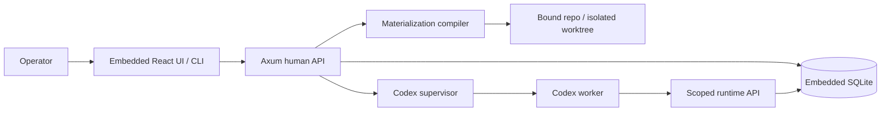

# Phase 0.1 — Revalidate the Codex foundation

**Status:** in_progress (local smoke GO; branch integration pending)
**Replanned:** 2026-10-12
**Depends on:** accepted Phase 0 foundation
**Estimate:** unestimated; size the next slice against its acceptance evidence before assigning dates.

## Purpose

Prove that the current runtime migration preserves the accepted materialization loop. August walks establish Claude behaviour only; this phase supplies current Codex and browser evidence before authoring depends on it.

## In scope

1. Real Codex startup from an isolated home: document how operator-provided model credentials are made available without writing secrets to a repo, compiled file, or backup. Verify project trust, MCP registration, skills, agent files, and hooks on the installed runtime. Inventory Codex, Node.js (the MCP command), git and hook utilities; embedded scripts do not bundle their interpreter.
2. Walk work-order fetch, span append, heartbeat, abort, lease expiry, failed startup and token revocation with real Codex. Preserve commit-free doc output and commit-producing work-order checks as distinct cases.
3. Render claim, bind, compile, dispatch, refusal, run spans and unmetered cost in a browser. Show network access as not enforced until a sandbox is proven.
4. Establish local check commands and CI for Rust offline-query builds/tests plus UI production builds. CI must not launch paid model runs or contain operator credentials.

## Done when

- A dated real-Codex walk records runtime version, tested commit, credential setup method, compiled files actually loaded, worker spans, heartbeat, completed git output and clean lease/token drain.
- A missing credential/MCP startup fails visibly; abort and silence reclaim leave inspectable records. No claim that a run succeeded solely because a shell substitute did.
- Browser evidence covers the full operator loop, including `cost n/m`, refusals and the truthful egress report; previous Phase 0 browser exceptions are explicitly discharged or remain listed.
- A fresh checkout passes documented Rust/UI checks; CI checks that path without model access.

## Anticipated specs

| Feature | Contract |
|---|---|
| codex-runtime-acceptance | Real runtime setup and adverse-path walk |
| foundation-browser-acceptance | Browser walk of existing loop |
| baseline-checks | Offline Rust and UI checks, CI |

## Out of scope

Canvas, new scheduler, provider registry, full network allowlist enforcement and dollar-budget guarantees. Preserve Phase 0 acceptance as historical evidence.

## Architecture

Existing Phase 0 containers only. This phase validates integration and distribution; it adds no graph scheduler.

## Acceptance evidence

Latest checkpoint: [2026-10-12 real-Codex follow-up](smoke-followup-2026-10-12.md), continuing the [investigation handoff](investigation-2026-10-12.md). **The local smoke verdict is GO with a documented browser-client navigation exception.** Work-order commit, timed abort, document output, silent lease expiry and required-MCP failure have observed results. Review-driven credential and document guards passed regressions. A fresh checkout of task commit `73b2b13146d3` passed locked UI installation/build and the Rust workspace build/tests, including explicit installed-CLI and macOS sandbox checks. The operator deferred hosted CI. The task branch still needs integration before this phase is accepted on main; no Phase 1.1 implementation is claimed. The [initial NO-GO walk](smoke-2026-10-12.md) remains historical evidence.

Local suites are regression evidence. Acceptance additionally needs a dated walk recording the commit, runtime version where relevant, observable rows/files/git objects, adverse cases, and any explicitly accepted exception. No phase closes from a spec status or passing mock-worker test alone.
