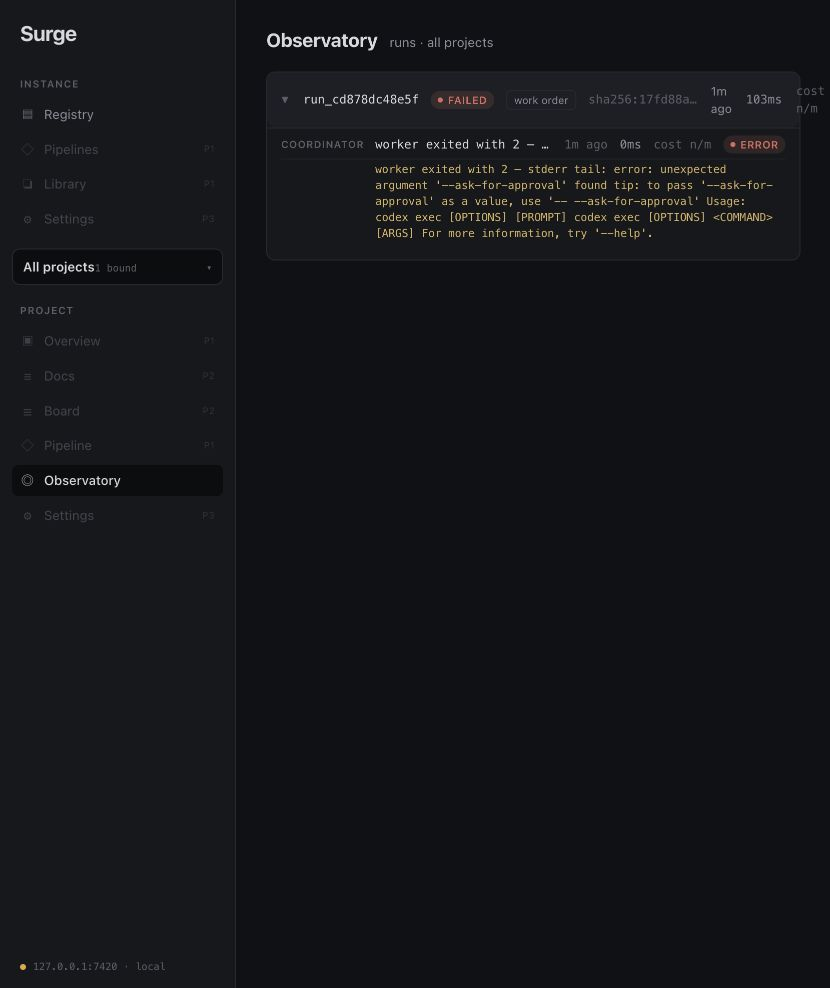

# Phase 0.1 acceptance walk — 2026-10-12

**Verdict: NO-GO.** Real Codex dispatch fails before runtime initialization. Phase 0.1 remains next; historical Phase 0 acceptance is unchanged.

## Tested environment

- Baseline commit: `210b2114a4b10bad7236431864724ce78eb02434`, with the current uncommitted roadmap and truthful capability-report changes. This was a working-tree walk, not a clean-checkout acceptance.
- Installed runtime: `codex-cli 0.160.0`; Node.js and git available. Fresh UI production build and `SQLX_OFFLINE=true cargo build --workspace` passed before launching the embedded server.
- Disposable repository/database under `/tmp/surge-acceptance-20261012-lragtw3k`; server launched outside the source checkout on `127.0.0.1:7420`. Only the disposable repo's commit signing was disabled to create the fixture. No operator model credentials were copied into the fixture.
- Browser: Codex in-app browser, fresh local claim/session. Claim navigation reported a client navigation error, but the subsequent root view was authenticated and binding/compile/dispatch succeeded. Authenticated behavior is proven; a seamless claim redirect is not.

## Findings

**F01 — blocking: the default worker command is incompatible with the installed CLI.** `SupervisorConfig::new` places `--ask-for-approval never` after `exec`:

```sh
codex exec --sandbox workspace-write --ask-for-approval never -
```

Run `run_cd878dc48e5f` exited with code 2 after 103 ms. The coordinator error span and rendered Observatory both contain `error: unexpected argument '--ask-for-approval' found`. No model session, MCP load, worker span or output commit was reached.

A parser-only check of `codex --ask-for-approval never exec --sandbox workspace-write --help` succeeds. Move the global flag before `exec`, guard the actual default command against CLI drift, then repeat the real walk. The corrected command has not been dispatched in this walk.

**F02 — documentation drift:** `integrations/claude-plugin/README.md` still describes the former Claude worker/configuration. Update it alongside the Codex startup and credential contract, after that contract is tested.

## Results

| Check | Result | Evidence / limit |
|---|---|---|
| Claim and authenticated browser use | Partial pass | Fresh claim screen followed by authenticated Registry; redirect navigation warning remains unresolved |
| Bind disposable repo | Pass | `surge.yaml` written; project visible in Registry |
| Compile seeded fixture | Pass | Materialized Codex config, agents, hooks, skills and `AGENTS.md`; capability dialog rendered |
| Truthful network report | Pass | Dialog says worker restrictions are not enforced and network access is enabled |
| Real Codex dispatch | Fail | F01; named failed run and coordinator error visible in Observatory |
| Failed startup drain | Pass | Issue failed, lease fields cleared, runtime token row revoked, worker worktree removed |
| Stale materialization refusal | Pass | Browser toast names `no fresh materialization`; refused run `run_cf5818d51e13` recorded |
| Unmetered cost rendering | Pass | Observatory displays `cost n/m`, not a dollar estimate |
| Fresh Rust regression suite | Pass | `SQLX_OFFLINE=true cargo test --workspace`: 117 passed, zero failed |
| UI production build | Pass | `npm run build` in `ui/` |
| Model credential delivery and loaded MCP/skills/agents/hooks | Blocked | CLI parser exits first; generated files alone do not prove loading |
| Real heartbeat, next-tool abort and silent lease expiry | Blocked | No live Codex session; regression tests remain separate evidence |
| Successful commit-free doc run and commit-producing work-order run | Blocked | No successful real Codex output |
| Clean-checkout checks and CI | Pending | This walk used the working tree; baseline CI slice remains unimplemented |

The stale case used an explicit test-fixture SQL update (`materialization.fresh=0`) in the disposable database after the failed dispatch. It proves the refusal UI/API path, not graph mutation invalidation. Token revocation was checked in persisted lifecycle rows; this walk did not capture/replay the runtime bearer credential.

## Evidence and next action

[Sanitized rows and git worktree state](evidence/2026-10-12/observations.json) preserve run IDs, exit span, lease drain and token revocation without credentials. The screenshot below shows the actual browser failure. Private database/logs remain in the disposable temporary directory; they are not committed artifacts. The disposable server was stopped after the walk.



Fix F01, verify the operator credential setup for the isolated Codex home, and repeat successful and adverse real-runtime cases before advancing to Phase 1.1. Historical browser exceptions remain open wherever the corresponding behavior was not exercised here.
