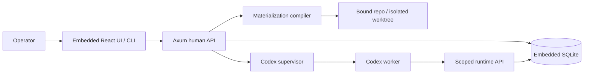

# Phase 1.1 — Minimal faithful authoring

**Status:** not_started
**Replanned:** 2026-10-12
**Depends on:** [phase-0.1](../phase-0.1/phase.md)
**Estimate:** unestimated; size the next slice against its acceptance evidence before assigning dates.

## Purpose

Author, assign and compile a small pipeline with a durable identity. Hash fidelity is necessary evidence here; graph-driven execution is a separate acceptance in 1.2.

## In scope

1. First repair legacy placeholder pipeline-hash metadata through the assignment prerequisite slice, preserving graph ids/content and recorded runs/materialization hashes with an audited versioned correction. Then expose hash-bearing reads, pipeline assignment and optional compile targeting; expose assignment, local revision, actual compiled source and freshness separately.
2. Durable project-local revisions, immutable published versions and promote-to-fork provenance. Semantic mutations commit atomically with audit and stale materialization; layout/label changes persist without changing the semantic hash.
3. Minimal canvas with six existing node kinds, opaque Block rendering, explicit edges, inspector, selection and undo/redo. Each completed mutation is saved; drag commits on gesture completion, not every pointer movement.
4. Text export/import with ids preserved, deterministic second export and lossless edge triggers. Add UI dependencies only where needed for the slice.

## Done when

- A populated pre-ESC-1 database upgrades without deletion or graph/run/history changes; repair is audited once and idempotent. Hash-bearing reads are enabled only after it completes.
- CLI/API assignment drives default compile, reassignment invalidates a mismatching materialization and stale dispatch is refused visibly.
- A semantic edit returns a durable revision hash and stales compilation atomically; UI shows saving until acknowledgement and blocks compile/dispatch while saving or failed. Retry preserves the attempted edit; failure never claims it is saved.
- Presentation-only mutations preserve the semantic hash and materialization freshness. Undo/redo of a semantic mutation creates a new revision rather than rewriting history.
- All six kinds survive API/canvas/text round-trip; a custom trigger named `passed` remains Custom, not Passed. Export → import → export is byte-identical for supported graph state.
- Forking preserves graph ids and source hash/provenance while leaving the published source untouched.

## Anticipated specs

| Feature | Contract |
|---|---|
| pipeline-assignment | Assignment and compile targeting; existing draft |
| pipeline-revisions | Revision lifecycle, mutation persistence and freshness |
| promote-to-fork | Immutable source, provenance and id preservation |
| canvas-editor | Minimal mutation-persisted graph UI; existing draft needs review |
| code-roundtrip | Lossless stored/text graph, ids and presentation fidelity |

## Out of scope

Library authoring (1.3), broad pipelines/overview pages, block composition, grouping, EVAL, dry run and visual diff (3.1). No graph-execution claim until 1.2.

## Architecture

Phase 0 containers plus graph/revision APIs and the minimal canvas; supervisor remains single-worker.

## Acceptance evidence

Local suites are regression evidence. Acceptance additionally needs a dated walk recording the commit, runtime version where relevant, observable rows/files/git objects, adverse cases, and any explicitly accepted exception. No phase closes from a spec status or passing mock-worker test alone.

## Carry-forward defects and decisions (2026-08-28–29)

| Defect | Evidence | Owner |
|---|---|---|
| **`EdgeTrigger` round-trips lossily, and it changes the hash.** `EdgeTrigger::Custom("passed")` serializes to JSON as `{"custom":"passed"}` but persists via `as_str()` as the bare string `"passed"` (`crates/store/src/pipelines.rs:57`) and reloads through `parse()` as the unit variant `Passed` (`crates/domain/src/pipeline.rs:154-166`). Those two produce different `SemanticEdge` JSON and therefore different `pipeline_content_hash` values — so a pipeline with a custom trigger colliding with a reserved word changes identity across save/reload | found during canvas-editor spec review, 2026-08-28 | `code-roundtrip` |

Latent in phase 0 because pipelines are seeded, never authored. The canvas is what exposes it.

| **A pre-existing database keeps placeholder `content_hash`.** Seed `exists()` skips existing rows. Reads that surface the column require an assignment-owned prerequisite repair preserving recorded runs and audit/provenance; disposable walk databases can be recreated, but existing operator state must not be deleted to make acceptance pass. | ESC-1 review, 2026-08-28; replan 2026-10-12 | `pipeline-assignment` prerequisite, before its hash-bearing reads |
| **`insert_graph` accepts whatever hash it is handed**, so the ESC-1 fix is one caller away from regressing. Today the seed is the only production caller (verified by grep across `crates/`, `ui/`, `integrations/`) | ESC-1 review, 2026-08-28 | **fixed 2026-08-29 by ESC-4** — `insert_graph` now derives `content_hash` from the graph it is inserting and returns it; the handed-in value is superseded. The second caller `pipeline-revisions` adds inherits this for free |

| **The two claim-lease refusals disagree about their audit subject.** `claim_lease`'s pre-existing `Ok(false)` branch records `subject = issue_id`; every other refusal records `subject = reason` (3 of 4). More sharply: `audit_entry` has **no `issue_id` and no `run_id` column** (`crates/store/migrations/0002_object_model.sql:200-207`), so `subject` is the only slot that can name the thing acted on — the new refusal row cannot identify *which issue* was refused from the audit trail alone, only by project + timestamp. Unify to `"{issue_id} — {reason}"`, the shape `runtime_api::refuse` already uses | ESC-2 review, 2026-08-28 | unassigned |
| **`refusal_run` seeds its run id on `{issue_id}{now}` at millisecond resolution.** Two claims for one issue in the same millisecond collide on the primary key, and the refusal answers 500 with nothing recorded — an INV-ERR-1 hole inside the fix for INV-ERR-1 holes. Pre-existing formula, but the claim path is the first place it is reachable by a retry loop against a pollable endpoint | ESC-2 review, 2026-08-28 | unassigned |
| **`dispatch_doc_run`'s unknown-project branch is still a recordless 500** (`crates/server/src/supervisor.rs`), while `dispatch_issue`'s analogue writes an audit row. The fourth refusal-shaped path; deliberately out of ESC-2's scope | ESC-2 review, 2026-08-28 | unassigned |

| ~~**`insert_fresh` lets a caller falsify the `NotCompiled` premise.**~~ **RESOLVED by ESC-5 (PR #7):** `insert_fresh` no longer reads `m.fresh` for the INSERT — the query hardcodes the literal, so no argument can produce a non-fresh row. Stronger than the `ensure!` this row suggested: the bad call is now unwritable rather than refused at runtime (walk-5 F1 pattern), and a reviewer verified the `ON CONFLICT` branch is covered too. **Consequence for `pipeline-revisions`:** the staling write that produces `Stale` — a project left with materializations of which none is fresh — can no longer be expressed by passing `fresh: false` to `insert_fresh`. It needs its own function. Original finding:  `crates/store/src/materializations.rs` writes `fresh` from the caller's struct. A caller passing `fresh: false` would stale the predecessors and insert a non-fresh successor — producing the `EXISTS(any) AND NOT EXISTS(fresh)` state that `NotCompiled`'s correctness depends on being unreachable, and the pill would then say "not compiled" about a project that *has* compiled. No caller does this today (the sole production caller sets `fresh: true`), so the premise is enforced by convention, not by the type system. `ensure!(m.fresh, …)` makes it structural | ESC-3 review, 2026-08-28 | `pipeline-revisions` — the task that makes the distinction load-bearing |
| **The project card's badge slot hides `unbound repo` behind `not compiled`.** `ui/src/registry.tsx` keeps a mutually-exclusive ternary whose first branch used to be unreachable and is now the common case, so a project that is both unbound *and* uncompiled shows "not compiled" while its actual next action is **bind**. Rare today because the UI create flow binds immediately, but it is a real user-visible change no test pins | ESC-3 review, 2026-08-28 | `project-overview` (3.1) or a direct fix |
| **`materialization.project_id` is not indexed.** SQLite creates no index for a foreign-key child column; the only index in the schema is `span_by_run`. The derived-status subquery is therefore a correlated full scan of `materialization` per project row. Irrelevant at single-user local scale, but the reason is worth stating correctly — add `CREATE INDEX materialization_by_project ON materialization(project_id)` whenever the next migration touches that table | ESC-3 review, 2026-08-28 | next migration author |
| **`POST /api/projects` commits the project insert and its audit row as two separate pool calls**, unlike the transactional pattern the bind path uses — an INV-DATA-8 gap on the create path. Pre-existing, unrelated to ESC-3 | ESC-3 review, 2026-08-28 | unassigned |

### Decided 2026-08-29 (ESC-4): `pipeline_content_hash` lives in `surge-domain`

*(Was "decide before `pipeline-revisions`". Settled and landed before that spec was written, because the same relocation closes the `insert_graph` defect above.)*

The ESC-1 reviewer's third option was taken: `pipeline_content_hash` and its `Semantic*` projection moved from `crates/compiler/src/hash.rs` to `crates/domain/src/hash.rs`, exported as `surge_domain::pipeline_content_hash`.

- **The no-new-edge premise held**, with one correction worth recording: it adds no *first-party* crate edge — `surge-domain` still depends on no workspace crate, and `surge-store` **lost** the `surge-compiler` dev-dependency ESC-1 had added. It is not literally dependency-free, though: `surge-domain` gains `serde_json`, `sha2` and `hex`, all already workspace dependencies already in the build graph.
- **`materialization_hash` stayed in `surge-compiler`.** Its third argument is `CompiledFile` — the exact bytes a compile emitted — and the object model has no type for a compiled file. Moving it would have dragged emission into `surge-domain` for no gain: nothing outside the compiler computes a materialization identity.
- **Output is unchanged, byte for byte.** The fixture hashed to `sha256:796565e8138a76f516d5a4fc71440b2526a7cf11bd301a4fff965d4e6de8a29d` before and after; `crates/domain/tests/hash.rs` now pins that literal, so the next edit to the semantic projection has to argue with a red test rather than a doc comment.
- **Consequences already banked:** `fixtures::two_node_pipeline()` takes no argument and derives its own identity (the residual gap ESC-1 could not close), and `insert_graph` derives rather than accepts.

**Done as ESC-4** (2026-08-29): `pipeline_content_hash` now lives in `surge-domain`, and `insert_graph` derives the hash rather than accepting one. Relocation was `role:critical` (code map: hash-input changes are serialized) and a reviewer verified from two independently built trees that no hash moved by a byte.
The alternative that looks obvious — having `insert_graph` call the compiler — was rejected as before: it would put `surge-store → surge-compiler` in the shipped graph.

### Carried from the ESC-4 review (2026-08-29)

**One shape, three instances, and the durable fix nobody has built.** `Project::pipeline_status` (ESC-3), `Materialization::fresh` (ESC-5) and `Pipeline::content_hash` (ESC-4) are now all *write-ignored* fields: the repository function owns the column, and the struct field is a read projection reused on the write path. The unifying rule the ESC-4 reviewer named is worth promoting to an invariant: **a repository write function owns any column its own name asserts, or that is a pure function of its other arguments.** The shared root cause is one struct serving both read and write; the durable fix is a write-side type per entity. Three doc comments are a convention; a type would be a guarantee.

**`serde_json` is now the canonical encoder inside the identity crate.** `pipeline_content_hash` serializes its semantic projection with `serde_json`, and that function now lives in `surge-domain`. A `serde_json` or `sha2` upgrade that changed map ordering or float encoding would silently re-key **every pipeline in existence**. The risk is pre-existing — it was equally true in `surge-compiler` — but it now sits in the crate that defines identity. The golden constant in `crates/domain/tests/hash.rs` is the **only** thing in the tree that would catch it; no relational assertion can. Treat a bump of either crate as `role:critical`.

**`insert_graph`'s `Result<String>` is vestigial today.** All six call sites discard the returned hash via `?` or `.unwrap()`; `#[must_use]` applies to the `Result`, not the payload, so nothing forces a caller to reconcile its in-memory `Pipeline` with the row. The shipped behaviour is right and the field now documents itself, but the doc comment claims more for the return value than the tree currently buys. Either a caller uses it or the claim should be softened.

## Sprint working note — spec depth (2026-08-29)

Five review rounds in this epic averaged ~12 blockers each. A large share were the spec **prescribing implementation mechanism** in prose and being wrong about it: a store-function signature that would not compile (`sqlx::Executor` consumes `self`, so a generic executor drives exactly one statement), a `LEFT JOIN` that could duplicate rows where the `EXISTS` it replaced could not, and a migration recipe that would have cascaded away every graph in the database.

**Decision: specs in this epic state contracts, not mechanism.** Acceptance criteria, wire shapes, invariants touched, seams, non-goals and grounded claims — yes. Store signatures, SQL shapes, module layout, migration recipes — no; those are settled against the compiler and the schema by the implementer, under the fresh-reviewer gate that already catches them. The template asked for "implementation sketch (short — the taskgraph decomposes it)" all along.

The reviews were not the problem: every grounded claim's *inference* held in the last round. The over-reach was.

Historical line anchors describe the reviewed commit. Open findings remain open until their owning change supplies evidence; the replan does not mark them fixed. Recordless refusals and refusal-id collisions are owned by 1.2; project-create/audit atomicity by 1.1; the materialization index by the next relevant schema migration.

## Feature order

Assignment identity-repair slice → assignment/list/compile targeting → revisions and graph API/DTO → minimal canvas and text round-trip → promote-to-fork acceptance. Text-trigger repair must precede dependent mutation acceptance. The canvas consumes revision-owned writes, never introduces a competing save endpoint.
