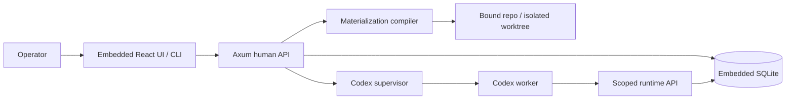

# Phase 1.2 — One graph-driven Codex run

**Status:** not_started
**Replanned:** 2026-10-12
**Depends on:** [phase-1.1](../phase-1.1/phase.md)
**Estimate:** unestimated; size the next slice against its acceptance evidence before assigning dates.

## Purpose

Prove the central product claim on one bounded executable graph: an implementer node runs, a deterministic verification stage observes its output, and graph edges determine completion or a bounded retry. A content hash alone is not an execution engine.

## In scope

1. Validate an executable graph and freeze its revision/materialization at dispatch. Start with one Agent plus one Stage and explicit passed/failed/retry edges; reject unsupported executable combinations by name, including unimplemented Block expansion.
2. Supervisor executes nodes from the frozen graph; stage commands execute in the same task worktree and verify the produced output. The real worker fetches the authoritative work order from a pointer plus hashes.
3. Run-to-node attribution, node-id validation, timings, stage exit codes and attempt records. Control flow uses observed process/stage results, never worker-written pass spans.
4. Required gates, bounded sequential retries, per-run metering/cap and abort checks between nodes. For retry edges persist an explicit limit, with no more than three retries; exceeding the limit terminates visibly. Unmeterable dispatch/run pauses behind an explicit human override gate, never silently costs zero.
5. Close the known refusal-record holes, millisecond refusal-id collision and audit-subject inconsistency before adding retry traffic.

## Done when

- On a real Codex run, modifying the verification command changes the observed result and selected edge; moving a node does not. Hash traceability and execution fidelity are both demonstrated.
- An injected verification failure follows the declared retry edge, reruns the implementer and stops at the persisted retry cap. A forged worker pass span cannot unlock verification.
- Unknown endpoints, invalid block membership, unsupported executable kinds, cycles outside bounded retry edges and missing/invalid stage configuration refuse visibly before spawning.
- Every executed node and attempt has a recorded node id, duration and outcome tied to the immutable run snapshot. Unknown or cross-run node ids are rejected.
- Editing the project mid-run stales future dispatch but never changes the active snapshot. Locked gates, abort and unmeterable cost halt the correct next node and require a recorded human action to proceed.

## Anticipated specs

| Feature | Contract |
|---|---|
| graph-execution-contract | Supported graph validation and immutable snapshot |
| node-execution | Agent then deterministic stage, authoritative fetch |
| node-attribution | Run/node/attempt identity and timing |
| sequential-control | Required gates, bounded retry, abort and per-run cap |
| refusal-integrity | Known refusal holes, identifiers and audit subjects |

## Out of scope

Parallel waves, taskgraph generation, tracker mirrors, automatic provider fallback, general Block execution and fanout. Existing six-kind authoring does not imply six-kind execution support.

## Architecture

Existing containers gain a minimal graph executor inside the supervisor and stage execution in its task worktree. Polling remains sufficient; no queue, mirror or SSE is required.

## Acceptance evidence

Local suites are regression evidence. Acceptance additionally needs a dated walk recording the commit, runtime version where relevant, observable rows/files/git objects, adverse cases, and any explicitly accepted exception. No phase closes from a spec status or passing mock-worker test alone.
