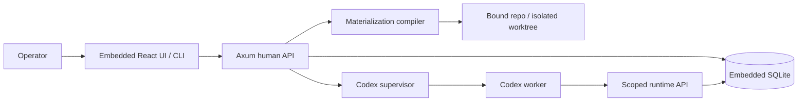

# Phase 1.3 — Library, trust and compile governance

**Status:** not_started
**Replanned:** 2026-10-12
**Depends on:** [phase-1.2](../phase-1.2/phase.md)
**Estimate:** unestimated; size the next slice against its acceptance evidence before assigning dates.

## Purpose

Expand the proven author/execute loop with reviewed reusable content. Published versions remain immutable, and capability lines distinguish declared intent from measured enforcement.

## In scope

1. Library hooks/subagents/skills, drafts and immutable publish.
2. Import as untrusted; review/unreview and compile refusal with audit.
3. Compile report and upgrade-review dialog with a minimal launch action in the library item detail; full composition-table launch is 3.1.
4. Full seven-hook, six-subagent, seven-skill default set. Translate content to Codex semantics and demonstrate behaviour rather than treating Claude frontmatter as an enforced capability.

## Done when

- Untrusted import refuses compilation naming the item; human review unblocks it and every transition is audited.
- Publish vN+1 leaves vN byte-identical and a pinned old pipeline still compiles and executes under its recorded snapshot.
- Upgrade review shows affected references and the diff before producing a new version; it can be exercised without waiting for 3.1 pages.
- Report separates declared library tools, supervisor stage commands and actual runtime/network restrictions. A `tools: WebSearch` line is never presented as a Codex permission guarantee.
- The default set is published through the library path, compiles, and its supported executable roles are exercised on the accepted runtime.

## Anticipated specs

| Feature | Contract |
|---|---|
| library-store | Draft/publish/pin immutability |
| trust-and-import | Reviewed import boundary and audit |
| compile-dialog | Declared capabilities and actual enforcement |
| upgrade-review | Diff, affected references, minimal launch surface |
| default-library | Codex-compatible normative content |

## Out of scope

Full network sandbox/allowlist policy and provider registry (2.2), broad authoring pages and Block UX (3.1), real evals (deferred).

## Architecture

Authoring and execution containers from 1.2, plus library/trust APIs and library dialogs; no new service.

## Acceptance evidence

Local suites are regression evidence. Acceptance additionally needs a dated walk recording the commit, runtime version where relevant, observable rows/files/git objects, adverse cases, and any explicitly accepted exception. No phase closes from a spec status or passing mock-worker test alone.
