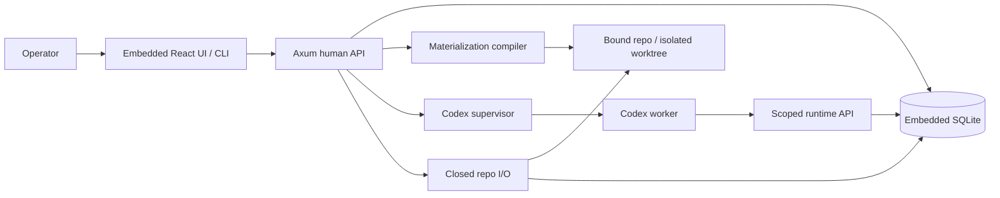

# Phase 2.1 — Approved taskgraph and Ops

**Status:** not_started
**Replanned:** 2026-10-12
**Depends on:** [phase-1.3](../phase-1.3/phase.md)
**Estimate:** unestimated; size the next slice against its acceptance evidence before assigning dates.

## Purpose

Turn approved repo-canonical taskgraphs into reviewed work orders and actionable Ops records before adding parallel scheduling.

## In scope

1. Repo I/O closed reads for declared docs and work orders, with ingestion/hash checks.
2. Minimal document approval control and taskgraph-to-issues generation; amendments preserve done and in-flight work.
3. Work-order revisions clear review; dispatch checks authoritative bytes and approved hash.
4. Minimal Ops board, gate unlock/relock actions and the actionable Needs-you queue.

## Done when

- Approving an actual taskgraph produces issues and rendered work orders; reapproval applies only the allowed diff.
- Work-order edits clear review; tampered bytes, missing approval and locked required gates refuse with visible reasons.
- Approve, revision and gate actions commit atomically with their audit entries.
- Ops and Needs-you show failed/refused/gated work and navigate to the relevant work order or run without an external tracker.

## Anticipated specs

| Feature | Contract |
|---|---|
| repo-io | Declared-doc ingest and work-order hash reads |
| taskgraph-to-issues | Approval and safe amendments |
| work-orders | Revision/review and authoritative bytes |
| board-ops | Minimal Ops, gates and actionable queue |

## Out of scope

External Plan mirrors (3.4), queue parallelism/budgets/SSE (2.2), wave PRs (2.3).

## Architecture

Adds repo I/O to the accepted single-run loop; taskgraph approval uses a minimal doc control rather than depending on the full Docs surface.

## Acceptance evidence

Local suites are regression evidence. Acceptance additionally needs a dated walk recording the commit, runtime version where relevant, observable rows/files/git objects, adverse cases, and any explicitly accepted exception. No phase closes from a spec status or passing mock-worker test alone.
