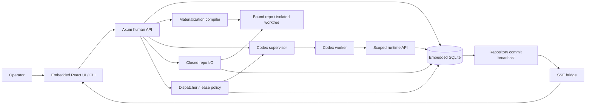

# Phase 2.2 — Bounded scheduling and live state

**Status:** not_started
**Replanned:** 2026-10-12
**Depends on:** [phase-2.1](../phase-2.1/phase.md)
**Estimate:** unestimated; size the next slice against its acceptance evidence before assigning dates.

## Purpose

Run multiple accepted graph executions with deterministic eligibility, recoverable leases, enforceable budgets and truthful live state.

## In scope

1. Queue priority/wave policy, max-parallel, retry queue and interactive claim capability.
2. Durable wave/per-role budgets extending 1.2 per-run metering; unmeterable remains gated. Use only providers supported and verified by the accepted Codex runtime.
3. Commit-then-broadcast store events, SSE snapshot/reconnect recovery and live lease/run indicators.
4. Network policy proof for supported platform: loopback and provider endpoints plus project allowlist, with enforced/declared labels based on actual facilities. Reject unenforceable enforced policy or explicitly gate a declared-only override.
5. Supported runtime model routing/fallback and provider-key handling; native supported integration only, no assumed Anthropic defaults or proxy bridge.

## Done when

- Eligible work executes in specified order with no more than max-parallel workers, and every worker owns a distinct worktree.
- Silence reclaims and queues one bounded retry; restart recovery cannot duplicate a lease or orphan a running row.
- Per-run/per-role/wave breach pauses correctly, writes a required gate and prevents further spawning. Unknown price/usage takes the unmeterable path.
- A committed state change reaches SSE; reconnect recovers a snapshot without lost or duplicated visible state.
- Allowed and forbidden network destinations are tested on the supported platform. Provider routing/fallback only claims combinations verified on real Codex.

## Anticipated specs

| Feature | Contract |
|---|---|
| dispatch-queue | Ordering, parallelism and eligibility |
| lease-recovery | Reclaim/retry/restart and interactive claim |
| budgets-metering | Run/role/wave costs and gates |
| sse-streaming | Commit broadcast and reconnect |
| runtime-policy | Verified providers, routing and egress policy |

## Out of scope

Wave assembly/PRs (2.3), external Plan mirrors (3.4), proxy providers and additional runtimes (deferred).

## Architecture

Adds queue policy and SSE to existing supervisor/repo I/O; no new datastore. Network policy remains platform-tested rather than inferred from a config string.

## Acceptance evidence

Local suites are regression evidence. Acceptance additionally needs a dated walk recording the commit, runtime version where relevant, observable rows/files/git objects, adverse cases, and any explicitly accepted exception. No phase closes from a spec status or passing mock-worker test alone.
