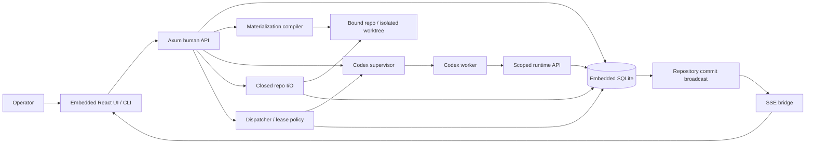

# Phase 2.3 — Wave integration

**Status:** not_started
**Replanned:** 2026-10-12
**Depends on:** [phase-2.2](../phase-2.2/phase.md)
**Estimate:** unestimated; size the next slice against its acceptance evidence before assigning dates.

## Purpose

Assemble completed task branches in dependency order into a reviewable wave PR without losing worker output on failures.

## In scope

1. Integration issue with dependency-ordered git assembly and deterministic contract checks.
2. Conflict reports and preserved task branch/output; cleanup policy must not destroy uncommitted evidence before it is recovered or explicitly discarded.
3. Wave PR creation, review handoff and recorded acceptance; credentials stay Surge-side.

## Done when

- A real multi-issue wave produces the expected commits in dependency order and a reviewable PR.
- Injected conflict or failed contract check halts assembly, names the failed input and preserves task branches/output for recovery.
- Retry/resume does not duplicate integration or mutate done/in-flight work. Refusal, assembly and PR records are inspectable.

## Anticipated specs

| Feature | Contract |
|---|---|
| wave-assembly | Dependency order and contract verification |
| integration-recovery | Conflicts, preservation and idempotent resume |
| wave-pr | Reviewable PR and recorded result |

## Out of scope

Automatic merge without operator policy, tracker mirrors, replay/debugger and provider expansion.

## Architecture

Uses 2.2 containers and repo I/O git operations. No tracker mirror is needed for integration.

## Acceptance evidence

Local suites are regression evidence. Acceptance additionally needs a dated walk recording the commit, runtime version where relevant, observable rows/files/git objects, adverse cases, and any explicitly accepted exception. No phase closes from a spec status or passing mock-worker test alone.
