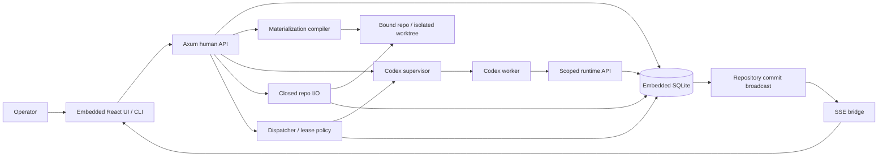

# Phase 3.1 — Authoring surfaces

**Status:** not_started
**Replanned:** 2026-10-12
**Depends on:** [phase-2.3](../phase-2.3/phase.md)
**Estimate:** unestimated; size the next slice against its acceptance evidence before assigning dates.

## Purpose

Expand navigation and authoring convenience over an already demonstrated executable pipeline.

## In scope

1. Pipelines list/detail, composition and history/diff; assignment picker and library upgrade-review launch.
2. Project overview with assignment/local revision/compiled source, fresh/stale state, binding and runs.
3. Dry run and builder diff using the same graph validation/plan as execution. Run overlay uses attributed node attempts.
4. Semantic Block composition/publish/exposed parameters, subject to explicit executor support; hash-neutral visual groups remain separate presentation state.

## Done when

- Pages navigate actual versions, pins, revisions and runs and show broken references distinctly.
- Dry run writes no run and dispatches nothing; unsupported graph forms refuse as execution does. Estimates carry their data source or say unavailable.
- Run overlay joins actual node ids and displays observed results; builder diff compares the current graph to the last compiled snapshot.
- Block membership/parameter edits change the semantic hash; collapse/layout edits do not. Unchanged block round-trip preserves hash. Execution is enabled only after deterministic expansion/equivalence tests pass.

## Anticipated specs

| Feature | Contract |
|---|---|
| pipelines-pages | List, detail, history and assignment picker |
| project-overview | Binding, assignment, revision and freshness |
| canvas-modes | Dry run, diff and attributed run overlay |
| blocks-and-groups | Semantic Blocks distinct from presentation groups |

## Out of scope

Prompt eval execution/calibration, synthetic token-budget bars, debugger (3.2), multi-user editing. EVAL remains deferred until a reproducible fixture runner and source for its numbers exist.

## Architecture

UI grows over accepted graph/execution/library APIs. Block execution, if enabled, extends the existing executor and is reviewed as semantic behaviour.

## Acceptance evidence

Local suites are regression evidence. Acceptance additionally needs a dated walk recording the commit, runtime version where relevant, observable rows/files/git objects, adverse cases, and any explicitly accepted exception. No phase closes from a spec status or passing mock-worker test alone.
