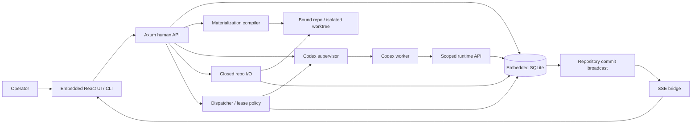

# Phase 3.2 — Observatory and improvement loop

**Status:** not_started
**Replanned:** 2026-10-12
**Depends on:** [phase-3.1](../phase-3.1/phase.md)
**Estimate:** unestimated; size the next slice against its acceptance evidence before assigning dates.

## Purpose

Trace a failure to its exact node and turn reviewed evidence into a new immutable pipeline version.

## In scope

1. Observed span waterfall, input/output view, node jumps and attempt context.
2. COE records and reviewed ratchet application to the next version.
3. Full Docs chain surface, approvals and parent-hash change/rederive flow.
4. Replay/debugger for supported graph snapshots, distinguishing a new execution from deterministic reproduction.

## Done when

- An actual failed node opens its waterfall and exact recorded graph version; a reviewed COE ratchet publishes a new version without altering prior runs.
- A changed parent doc invalidates dependent approval and shows both hashes; rederive restores approval only after completion.
- Replay uses the recorded snapshot and records a new run with lineage; missing pins/input or compacted bodies refuse visibly.
- Debugger steps the same supported plan as execution and never implies deterministic model output.

## Anticipated specs

| Feature | Contract |
|---|---|
| observatory-waterfall | Observed span/node/attempt inspection |
| coe-and-ratchet | Reviewed evidence to next version |
| docs-surface | Doc chain and parent approval |
| replay-debugger | Snapshot lineage and supported stepping |

## Out of scope

Calibrated quality metrics, evals and additional runtimes (deferred), retention/settings (3.3).

## Architecture

Existing containers plus richer Observatory/Docs APIs and surfaces; no separate graph or vector datastore.

## Acceptance evidence

Local suites are regression evidence. Acceptance additionally needs a dated walk recording the commit, runtime version where relevant, observable rows/files/git objects, adverse cases, and any explicitly accepted exception. No phase closes from a spec status or passing mock-worker test alone.
