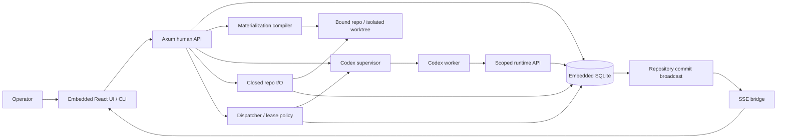

# Phase 3.3 — Operations and retention

**Status:** not_started
**Replanned:** 2026-10-12
**Depends on:** [phase-3.2](../phase-3.2/phase.md)
**Estimate:** unestimated; size the next slice against its acceptance evidence before assigning dates.

## Purpose

Make the state recoverable and its retained metrics honest without growing deployment scope.

## In scope

1. Retention body compaction with immutable span structure and dependent replay refusals.
2. Measured status/latency/cost rollups with unknown values explicit.
3. Settings for accepted runtime providers, network policy, token rotation and credentials.
4. Backup/restore to operator-configured state remote with no tokens/keys, fresh claims and reminted credentials; global empty/degraded/refusal surface pass.

## Done when

- Compaction removes body data and dependent index copies and preserves structural facts; replay refuses compacted input.
- Metrics reconcile to observed runs and costs; unknown cost does not become $0.
- Rotation invalidates old sessions; backup/restore round-trip retains project/pipeline/audit state while excluding credentials.
- Every shipped empty/degraded/refusal surface has a walked state and recovery action.

## Anticipated specs

| Feature | Contract |
|---|---|
| retention | Body deletion and structural preservation |
| metrics | Measured rollups and unknowns |
| settings-operations | Runtime policy, rotation and backup/restore |
| state-copy-pass | Shipped-surface adverse states |

## Out of scope

Proxy providers, real quality calibration, remote access and multi-user support.

## Architecture

No new containers; retention job and operational APIs live inside the existing process.

## Acceptance evidence

Local suites are regression evidence. Acceptance additionally needs a dated walk recording the commit, runtime version where relevant, observable rows/files/git objects, adverse cases, and any explicitly accepted exception. No phase closes from a spec status or passing mock-worker test alone.
