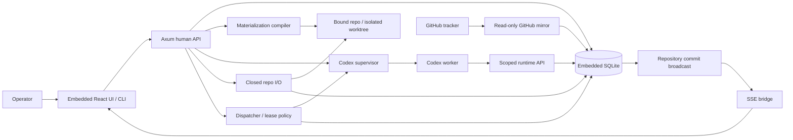

# Phase 3.4 — Plan board and external mirrors

**Status:** not_started
**Replanned:** 2026-10-12
**Depends on:** [phase-3.3](../phase-3.3/phase.md)
**Estimate:** unestimated; size the next slice against its acceptance evidence before assigning dates.

## Purpose

Complete the Plan/Ops linkage after proving delivery value without duplicating tracker surfaces first.

## In scope

1. Built-in tracker record create/edit and Plan views, kept separate from Ops status.
2. Read-only GitHub mirror and polling, no external tracker mutation.
3. Divergence detection, Needs-you jumps and board planning views; Linear remains deferred.

## Done when

- Built-in issue edits write tracker records only; external fields remain read-only.
- A mirrored issue closed during an in-flight work order shows divergence on both halves and in Needs-you; no automatic reconciliation occurs.
- Sync failure and stale mirror state are visible and recoverable, without affecting the authoritative Ops lifecycle.

## Anticipated specs

| Feature | Contract |
|---|---|
| built-in-plan | Writable tracker records and Plan views |
| tracker-mirror | Read-only GitHub polling |
| plan-ops-divergence | Cross-board linkage and actionable disagreement |

## Out of scope

Linear implementation, tracker writes, remote webhooks and multi-user collaboration.

## Architecture

Adds read-only tracker mirror to the already accepted delivery/observability containers; the store remains the sole transaction boundary.

## Acceptance evidence

Local suites are regression evidence. Acceptance additionally needs a dated walk recording the commit, runtime version where relevant, observable rows/files/git objects, adverse cases, and any explicitly accepted exception. No phase closes from a spec status or passing mock-worker test alone.
